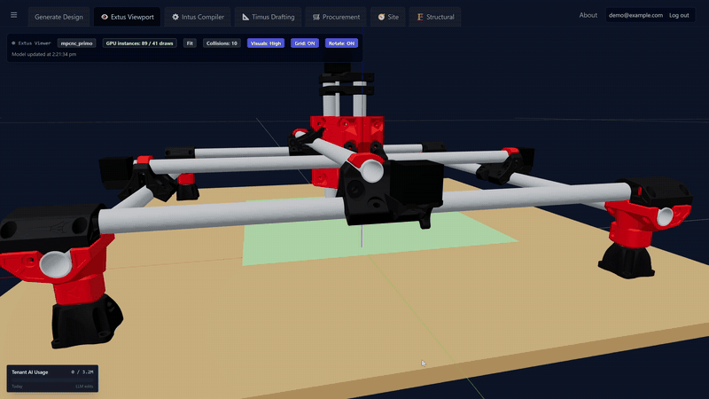
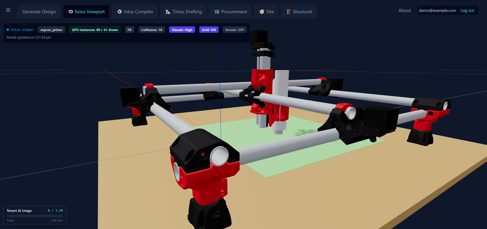

# MPCNC Primo (J / 25.4 mm) - Tertius model

Tertius project: `mpcnc_primo`. Edit `params.json` (footprint, tool, pose, colours), then recompile.





- **Printed parts** are V1 Engineering's own J STLs
  ([MPCNC_Primo](https://github.com/V1EngineeringInc/MPCNC_Primo),
  [55mm mount](https://github.com/V1EngineeringInc/MPCNC_Primo_Tool_Mounts), CC BY-NC-SA 4.0),
  decimated by vertex clustering on a 0.35 mm grid and stored as `mesh_<part>.json`
  (int16 vertices at 0.02 mm, zlib + base64). V1's "Mirrored" parts are the same meshes reflected.
- **Tubes** follow V1's cut calculator (`primo_calc.py`, offsets copied from docs.v1e.com/mpcnc/calculator).
- **Steppers, leadscrew and spindle** are simple stand-ins. Bearings, bolts and belts are not drawn.

## How each part is placed

V1 publishes no assembly, so every part was located from its own geometry (bore fits, bolt holes
and mating faces measured from the STLs), then checked against V1's build photos:

| Part | Located by |
|---|---|
| Foot, Leg | leg seated to the table through the foot bore |
| Corner Leg Lock | printed upside down; 8 mm floor sits on the leg top |
| Corner Bottom | leg screw hole coaxial with the leg; lower (Y) rail in its U-slot |
| Corner Top | 4-bolt pattern on the Bottom, turned 90 degrees; upper (X) rail in its U-slot |
| Lower/Upper Belt | sliders in the corner slots, against the end-face screw |
| Truck | two top bearings (M8 at 107.77) ride the rail; gantry saddle 43.7 mm above rail centre |
| Truck Clamp | on the gantry tube in the saddle, centred over the rail |
| Core | gantry channels (r 15.08) fitted; 45 degrees, open face to the 0,0 corner |
| Core Clamps | their angled bearing bolts (60 degrees) matched to holes in the Core; 3 bearings at 120 degrees |
| Z Motor / Z Coupler | rail bores share the Core's frame (71.46 mm rail spacing); the Coupler is the same plate flipped |
| Tool Plates, 55mm mount | rail cups on the Z rails; the mount nests in the plates' 44.4 mm arc |
| Core Z Clamps | **approximate** - on the Core's front ears, top and bottom |

Cross-checks: the corner stack gives 25.96 mm + gap between rails, and the core's channels
27.5 mm, so the corner gap is about 1.5 mm (V1's "even gap"). The model's overall width is
861 mm against the calculator's 865 mm footprint.

## Findings

- **Work area:** truck travel is 556 mm per axis. With the core, Z axis and mount kept clear of the
  trucks (bounding boxes, so conservative) the tool covers about 453 mm, against V1's 490 x 481 mm.
  The work area sits about 44 mm toward the 0,0 corner from the frame centre.
- **Z height:** at the lowest Z (Z Coupler on the Core) the Z rail bottoms are about 12 mm below the
  table top, and the bit tip about 64 mm below it with the default spindle stick-out. In practice
  the work surface needs to sit above the table (spoilboard/bed), or the tool can't use the full 81 mm.
  Worth checking against your own tool before cutting the legs.

## Cut list

```
MPCNC Primo J, 865 x 865 footprint, tool 55mm
work area     490.0 x 481.0 x 81.0 mm
  2 x x_rail      797.0 mm
  2 x y_rail      797.0 mm
  1 x x_gantry    742.0 mm
  1 x y_gantry    742.0 mm
  2 x z_rail      273.5 mm
  4 x leg          62.5 mm
tube total    5505 mm (3 mm kerf)
belt          2 x 847 + 2 x 847 = 3388 mm of 10 mm GT2
table (feet)  763 x 763 mm
```

## Viewer note

The Tertius viewer merges every non-instanced mesh into one geometry. Before Tertius-Web
commit 64f6f31 (PR #411), a primitive without NORMALs made that merge fail and the whole batch
vanish, so the mesh parts here are built with creased normals. The work-area plate is opaque.

## Licence and attribution

The printed-part meshes are derived from **Mostly Printed CNC** (MPCNC Primo) and
**Mostly Printed CNC Tool Mounts** by [V1 Engineering Inc](https://www.v1engineering.com/),
licensed under [CC BY-NC-SA 4.0](https://creativecommons.org/licenses/by-nc-sa/4.0/).
Original files: [V1EngineeringInc/MPCNC_Primo](https://github.com/V1EngineeringInc/MPCNC_Primo)
and [V1EngineeringInc/MPCNC_Primo_Tool_Mounts](https://github.com/V1EngineeringInc/MPCNC_Primo_Tool_Mounts).

Changes from the originals: the STLs were decimated (0.35 mm vertex clustering), quantised to
0.02 mm and repacked as `mesh_<part>.json`, and placed into an assembly by `design.py`. The cut
calculator offsets in `primo_calc.py` come from V1's documentation.

As required by the ShareAlike term, this whole repository is released under the same licence,
**CC BY-NC-SA 4.0** (see `LICENSE`). This is a personal model of one machine; it is not made or
endorsed by V1 Engineering. Don't sell parts printed from these files. V1 asks that its designs
and the parts they make not be sold, and that sales of parts for a single privately printed
machine go through its forum. Get the real parts from V1 Engineering's own downloads, not from
these decimated meshes.
